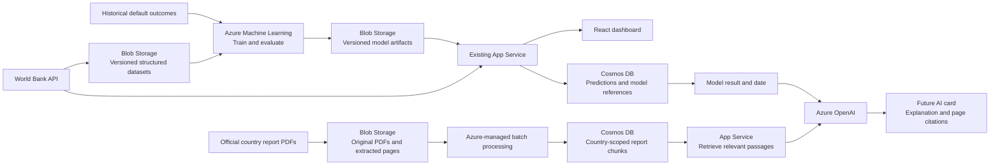

# VEGA Azure implementation handoff

Prepared November 17, 2026. This is an implementation handoff for Windows VS Code
with Azure CLI authentication and GitHub over SSH. The current request is for
instructions. Resource changes and deployment are separate user-controlled steps.

The latest execution choice is training on the Windows laptop and publishing
research result JSON for the existing hosted frontend. Follow
[local training](LOCAL_TRAINING.md) for that path. Azure ML remains an optional
later training environment; the broader storage migration below is still planned.

Confirmed storage mapping: `sovernriskai` is the data lake, and `sovernriskaiv1`
is Blob storage. Use `sovernriskaiv1` for the prediction result bundle.

The user currently lacks Blob Contributor access. The immediate delivery path
packages the local prediction JSON with the App Service release using
`--predictions-file`, as described in `LOCAL_TRAINING.md`. It uses the existing
authorized deployment channel and needs no storage role assignment.

GitHub Releases are disallowed. The user now authorizes the reviewed Windows
JSON at `deploy/frontend_predictions.json` in Git. Packaging automatically
includes it; see `deploy/README.md` for copy/commit/push instructions. Other
generated artifacts remain excluded, and Azure deployment remains manual.

## Azure service plan

| Service | Purpose | Stage |
| --- | --- | --- |
| Existing Azure App Service | Serve the React build and FastAPI together. Fetch World Bank data, serve country data, load a trained model for lightweight inference, and later coordinate RAG answers. | Current hosting |
| Existing Azure Blob Storage | Store original API downloads, versioned training datasets, original report PDFs, extracted page files, model artifacts and exports. | Storage migration |
| Existing Azure Cosmos DB | Store country/report metadata, run status, model-version references, country predictions and searchable report chunks. | Storage migration |
| Azure Machine Learning | Run structured-data training and evaluation on managed Azure compute. Batch data/PDF preparation can also run as Python jobs there. Export versioned model artifacts into Blob Storage. Discover and reuse a workspace if one exists. | ML phase |
| Azure OpenAI | Generate cited explanations from retrieved report passages and actual model outputs. An embedding deployment can support semantic retrieval later. Discover existing resources/deployments first. | RAG phase |

Azure ML supports Blob-backed data assets and identity-based storage access. Its
curated environments provide managed runtime options for cloud jobs.
[Azure ML data](https://learn.microsoft.com/azure/machine-learning/concept-data),
[curated environments](https://learn.microsoft.com/azure/machine-learning/concept-environments).

Cosmos DB for NoSQL can store vectors alongside document data. Enable semantic
retrieval only after checking the existing account's API, throughput mode,
capabilities and container policies. The initial country-scoped BM25 retriever
can operate on text chunks stored in Cosmos DB. The storage migration can proceed
before vector search is configured.
[Cosmos vector search](https://learn.microsoft.com/en-us/azure/cosmos-db/vector-search).

For scanned reports, an Azure AI Document Intelligence OCR step can be proposed
later if readable text extraction fails. The current dashboard presents AI / RAG
as Coming soon.

## Intended data flow



## Current repository facts

- The GitHub repository is `git@github.com:Kuppudi/sovernrisk.git`.
- Commit `84d5275` contains the interactive map, metric toggle and history dropdown.
- World Bank frontend reads already use `/api/live/world-bank/...`, with a
  five-minute in-memory cache for ten indicators and 2015–2025.
- Durable storage code still uses SQLAlchemy and PostgreSQL. Cosmos DB support
  needs application changes across the storage and query paths.
- `/health` still opens a SQL database session. This also needs migration.
- PDF originals currently use `REPORT_DATA_DIR` on disk. Metadata and chunks use
  SQL tables. The RAG prompt currently gets economic context from stored SQL data.
- The public UI has map selection, default-risk/GDP-growth toggles, compact
  fundamentals, and a history indicator dropdown. AI / RAG says Coming soon.
- The production default-risk model is unavailable. A local retrospective
  experiment exists, with research artifacts and historical test predictions.
- The ML starter delivery includes `ml/default_training.py`,
  `notebooks/default_training.ipynb`, tests and optional ML dependencies.
  Raw datasets, the label workbook and generated research models
  remain outside Git and must be supplied separately.
- Both `.github/workflows/main_sovernriskai.yml` and
  `.github/workflows/app-service.yml` require a manual dispatch from main for
  deployment. Ordinary source pushes perform CI/package checks only.

## Prompt to paste into the Windows VS Code coding agent

Copy this section through the end of the acceptance criteria into the agent.

### Objective and working constraints

Continue VEGA in the existing repository. Use the existing Azure App Service,
Blob Storage account and Cosmos DB account for the application's cloud runtime
and durable storage. Develop with Windows PowerShell, native Python and Node.js,
the authenticated Azure CLI session, and the configured GitHub SSH connection.

The target uses Azure storage services. Docker, PostgreSQL Flexible Server,
local PostgreSQL services, database emulators and container builds are outside
this implementation. Run cloud ML jobs with Azure-managed compute and curated
environments when that later phase is authorized.

Implement on a feature branch. Preserve existing files, cloud data and the current
frontend behavior. Prepare code, tests, configuration examples and run instructions.
Publishing, merging into a deployment branch, creating Azure services, starting
billable compute and changing service tiers/throughput require a later explicit
instruction. Azure discovery commands below are read-only.

Inspect `.github/workflows/main_sovernriskai.yml` and
`.github/workflows/app-service.yml`. Preserve their manual-only deployment
controls and CI build/test/package checks. Ordinary source pushes must not
release the app. Merge only when requested; Azure publishing needs a separate
explicit instruction.

### 1. Discover the existing resources

Verify the active subscription, App Service, storage account and Cosmos account
with Azure CLI. Discover their real resource groups, endpoints, identities,
network configuration and existing logical containers. Inspect metadata before
reading application data. Ask which resource to use only if discovery leaves
multiple plausible choices.

Identify the Cosmos API before selecting a driver. The container design below
targets Cosmos DB for NoSQL using `azure-cosmos`. A MongoDB account needs its
matching driver and query implementation. Preserve the existing account and
report the detected API and any required design adjustment.

Inspect existing Azure ML workspaces and Azure OpenAI resources as part of the
later service inventory. Record what already exists and what remains planned.

### 2. Authentication and permissions

Use Azure Identity credentials backed by Azure CLI during Windows development
and the App Service managed identity when hosted. Reuse SDK clients and
credentials through the app lifecycle. Git operations use the configured SSH
remote.

List required data-plane role assignments for the developer identity, App Service
identity and later Azure ML compute identity. Show exact resource scopes and
proposed commands for permissions that are missing.

- Blob readers need Storage Blob Data Reader. Writers need Storage Blob Data
  Contributor on the relevant VEGA containers.
- Cosmos DB for NoSQL uses its native Cosmos DB Built-in Data Reader or
  Cosmos DB Built-in Data Contributor roles. Match permissions to the operations
  and scope them to the application's data where supported.
- Azure OpenAI callers need Cognitive Services OpenAI User when Entra
  authentication is used.

The developer identity, App Service identity and ML compute identity are separate
principals. Verify each principal's access to its required data paths.
[Python Azure authentication](https://learn.microsoft.com/en-us/azure/developer/python/sdk/authentication/local-development-dev-accounts),
[Cosmos data-plane roles](https://learn.microsoft.com/en-us/azure/cosmos-db/reference-data-plane-security),
[Azure OpenAI keyless access](https://learn.microsoft.com/en-us/azure/developer/ai/keyless-connections).

### 3. Blob Storage responsibilities

Reuse compatible existing containers. Otherwise propose these application
namespaces and the configuration needed to create them.

| Container | Contents |
| --- | --- |
| `vega-data` | Original World Bank responses, normalized datasets, training snapshots, manifests and exports |
| `vega-reports` | Original PDFs and extracted page/chunk files |
| `vega-models` | Trusted versioned model artifacts, feature schemas, evaluation metrics and dependency metadata |

Use immutable versioned paths and SHA-256 hashes. Preserve provider URLs,
retrieval timestamps, observation years, source revision dates and explicit nulls.
Keep large files in Blob Storage and references in Cosmos DB. Temporary local
files used during parsing/building are disposable.

Keep frontend requests on the World Bank API with short memory caching. Write
reproducible training snapshots through an explicit data-preparation job.
[Blob Storage overview](https://learn.microsoft.com/en-us/azure/storage/blobs/storage-blobs-overview).

### 4. Cosmos DB document design

Inspect existing containers and partition keys first. For a compatible NoSQL
account, propose the following small document model, adapting names to existing
application containers where appropriate.

| Container | Partition key | Documents |
| --- | --- | --- |
| `catalog` | `/type` | Country/indicator metadata, run manifests, model-version metadata and active-version references |
| `country-state` | `/countryIso3` | Versioned country predictions, current-result pointers and country report metadata |
| `report-chunks` | `/countryIso3` | Page-preserving text chunks and optional future embeddings |

Use stable IDs, uppercase ISO3 codes, UTC timestamps and `schemaVersion` fields.
Preserve existing external API field names through serialization, even if the
internal document representation uses camelCase. Point reads must supply both
the item ID and partition key. Handle Cosmos query continuation tokens.

Prediction documents need target definition, forecast/as-of date, model version,
input snapshot reference, feature schema and availability status. Report chunks
need report ID, country, report date, PDF page, chunk number, text, original source
URL, Blob reference, content hash and processing version.

Design retries and partial completion explicitly. Upload immutable files first,
then write metadata, then mark the version complete. Readers use complete
versions. Use stable IDs for retry-safe writes and ETag conditions for mutable
current-version pointers. Cosmos transactional batches have a logical-partition
boundary. Blob and Cosmos writes need a completion/recovery protocol.
[Cosmos transactions and ETags](https://learn.microsoft.com/en-us/azure/cosmos-db/database-transactions-optimistic-concurrency).

### 5. Port the actual application paths

Read the current code before making changes. Reuse the World Bank connectors,
CSV validation, observation schemas, content hashing and frontend API contracts.

Add small Azure client/storage modules for Blob and Cosmos. Migrate these owning
paths and their callers in a coherent pass.

- `backend/app/core/config.py` and `backend/app/db/session.py`
- `backend/app/api/routes.py`, including `/health` and persisted-data endpoints
- `backend/app/services/observations.py`, `reports.py` and related exports
- `ingestion/pipelines/storage.py`, `runs.py` and `ingestion/cli.py`
- `backend/app/services/debt_reports.py` and `report_rag.py`
- SQLAlchemy-backed report models and tests that currently assume SQL sessions

Move generic timestamp helpers out of ORM modules where needed. The application
must start and serve its normal paths with Azure configuration alone. Update
health/readiness checks for the chosen stores. Preserve latest-vintage behavior,
including later null revisions, and preserve queryable historical snapshots.

Store PDF originals in Blob Storage and chunk/report metadata in Cosmos DB.
Serve cited PDFs through controlled application URLs backed by their immutable
Blob versions, or use their original official source links. Retain PDF page
numbers and country scoping. Update the RAG economic context path to use the
selected live data or explicit Blob snapshot.

Update `.env.example`, dependencies, documentation and CI after the storage paths
are ported. Replace PostgreSQL-specific CI services/migration checks with
Azure-adapter unit tests and explicitly enabled integration checks. Preserve
history and existing data during the transition.

### 6. Prepare the ML phase

Check whether the training module/notebook is present in this Windows checkout.
If it is missing, obtain the latest main source before starting this
phase. The storage work can proceed independently. Supply the input snapshot and
official label workbook separately; source checkout does not include them.

Plan training on Azure ML managed compute using versioned Blob datasets and
documented default outcomes. The frontend window stays 2015–2025. Training can
use a longer historical window when the experiment requires it.

Preserve the nine-feature research schema when reproducing that experiment.
Total GDP is an additional frontend indicator. Define the prediction event and
horizon, retain chronological evaluation and baseline comparisons, and record
calibration/coverage limitations. Export artifacts and metadata into `vega-models`
and reference complete model versions from Cosmos DB.

Plan lightweight inference in the existing App Service for an appropriate model.
Use actual model outputs for country scores and expose their target, model
version and as-of date. The current unavailable state represents the production
model's present status.

### 7. Prepare the RAG phase

Keep the public AI / RAG card as Coming soon during the storage migration.

Reuse official report discovery. Store originals in Blob, extract text by page,
and persist country-scoped chunks in Cosmos DB. Initial BM25 retrieval can use
those chunks. For semantic retrieval, inspect Cosmos vector-search support and
the embedding deployment before defining vector dimensions/index policies.
Document any throughput or container change required by the existing account.

Azure OpenAI receives retrieved passages, current model availability/results,
structured-data context and their dates. Return concise explanations with valid
page citations. Model feature contributions and report evidence have separate
provenance. Handle missing reports and model outputs explicitly.

Replace the prototype's API-key-only generation configuration with Azure Identity
authentication for the selected Azure OpenAI endpoint and deployment. Determine
generation readiness from the intended configuration and authenticated access.
[Azure OpenAI v1 and Entra authentication](https://learn.microsoft.com/en-us/azure/ai-foundry/openai/api-version-lifecycle).

### 8. Required deliverables and acceptance criteria

1. Report the discovered Azure resource names, Cosmos API, endpoints, identities
   and proposed container mapping, with credentials omitted.
2. Show the code diff for Blob/Cosmos persistence and manual deployment control.
3. Verify startup, health, country data, history, metric toggles and map controls
   through normal entry points using Azure configuration.
4. Verify retry-safe writes, incomplete-run recovery, null preservation,
   partition scoping, report citations and failed-refresh recovery.
5. Run Windows-native Python checks and the frontend production build. Use
   mocked SDKs for ordinary unit tests. Identify any real Azure integration
   checks and their isolated test namespaces before running them.
6. Provide exact remaining resource/RBAC configuration commands and a separate
   manual deployment procedure for user review.
7. Update `.github/copilot-instructions.md`, `.env.example`, `docs/PROJECT_STATE.md`
   and `docs/DECISIONS.md` to reflect the current Blob/Cosmos architecture.

## Windows PowerShell discovery commands

Run these from VS Code's PowerShell terminal. They inspect the current Azure
subscription and resource metadata.

```powershell
az account show --output table
az webapp list --query "[].{name:name,resourceGroup:resourceGroup,host:defaultHostName}" --output table
az storage account list --query "[].{name:name,resourceGroup:resourceGroup,blob:primaryEndpoints.blob}" --output table
az cosmosdb list --query "[].{name:name,resourceGroup:resourceGroup,kind:kind,capabilities:capabilities[].name,endpoint:documentEndpoint}" --output jsonc
az resource list --resource-type Microsoft.DocumentDB/mongoClusters --output table
az resource list --resource-type Microsoft.MachineLearningServices/workspaces --output table
az resource list --resource-type Microsoft.CognitiveServices/accounts --output table
```

For a fresh checkout, choose a Windows working directory and clone over SSH.
For an existing checkout, preserve its current work and open that folder.

```powershell
git clone git@github.com:Kuppudi/sovernrisk.git
Set-Location .\sovernrisk
git status --short
git switch -c feature/azure-blob-cosmos-storage
git ls-files ml/default_training.py notebooks/default_training.ipynb
code .
```

After the agent has updated the Azure dependencies and the relevant tests,
Windows-native build/check commands can use the virtual environment directly.

```powershell
py -3.13 -m venv .venv
.\.venv\Scripts\python.exe -m pip install -e ".[dev]"
.\.venv\Scripts\python.exe -m pytest -q
Push-Location frontend
npm ci
npm run build
Pop-Location
.\.venv\Scripts\python.exe -m scripts.package_app_service
```

## Proposed application settings

Use the actual discovered values. These are a target configuration contract for
the storage port and need matching code changes.

```dotenv
AZURE_STORAGE_ACCOUNT_URL=https://<existing-storage-account>.blob.core.windows.net
BLOB_DATA_CONTAINER=vega-data
BLOB_REPORTS_CONTAINER=vega-reports
BLOB_MODELS_CONTAINER=vega-models
COSMOS_ENDPOINT=https://<existing-cosmos-account>.documents.azure.com:443/
COSMOS_DATABASE=vega
COSMOS_CATALOG_CONTAINER=catalog
COSMOS_COUNTRY_CONTAINER=country-state
COSMOS_CHUNKS_CONTAINER=report-chunks
WORLD_BANK_BASE_URL=https://api.worldbank.org/v2
AZURE_OPENAI_ENDPOINT=https://<existing-openai-resource>.openai.azure.com
AZURE_OPENAI_DEPLOYMENT=<chat-deployment-name>
AZURE_OPENAI_EMBEDDING_DEPLOYMENT=<embedding-deployment-name>
```

The Cosmos endpoint/SDK/settings above apply to a verified NoSQL account.
The OpenAI values belong to the later RAG phase. Use the App Service's existing
built-in Python runtime and the React/Python application ZIP for a future manual
release. The existing `startup.sh` serves both parts through FastAPI.
