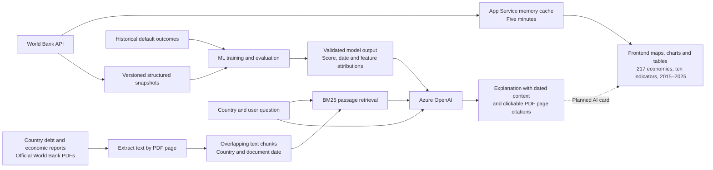

# VEGA data and explanation flow

The current user interface shows AI / RAG as Coming soon. Country fundamentals
are visible directly below the map. The report processing and explanation
services below are backend groundwork for the planned AI card.



World Bank frontend reads use the official WDI download API and a bounded
five-minute process memory cache. These requests do not write observations to
PostgreSQL or disk. Download responses include country/indicator definitions and
revision dates. Existing imports remain available for reproducible ML training.

PDF discovery searches the World Bank Documents & Reports catalog for the selected
country using its two-letter country code. The ten newest matching English debt,
economic update, public finance, public expenditure and Macro Poverty Outlook
reports are offered. A country can have no matching reports, and its newest
available report can be older than the current year. This catalog covers World
Bank publications and published joint Bank–IMF DSAs.

Load a PDF to extract and persist chunks with their original PDF page numbers.
Search operates only on that country's processed reports, optionally limited to
selected reports. BM25 supplies up to six page passages. Azure OpenAI receives
these passages, model availability and stored economic observations, and returns
a cited explanation. Report evidence provides economic context. Actual model
feature attributions are required to explain the model's prediction drivers.

The current offline model remains retrospective research. A validated production
score is unavailable. The explanation endpoint reports that status explicitly.

## Server setup

```sh
python -m pip install -r requirements.txt
python -m alembic upgrade head
```

Configure an existing Azure OpenAI chat deployment through server environment
variables `AZURE_OPENAI_ENDPOINT`, `AZURE_OPENAI_DEPLOYMENT` and
`AZURE_OPENAI_API_KEY`. The endpoint may be the resource root or its `/openai/v1`
base. The API key stays server-side. The deployment must support JSON chat
completion responses. No Azure resource is provisioned by these changes.

Set `REPORT_DATA_DIR=/home/sovereignrisk/reports` on App Service for persistent PDF
archives, and back up these files together with PostgreSQL. The migration adds
report metadata and page chunk tables. Run it from the deployed App Service
environment with private PostgreSQL access before using report research.

PDF search works without generation credentials. Azure-generated answers require
the three settings above. Scanned PDFs without readable text need OCR before
processing. Initial limits are 32 MB and 500 pages per report. Refresh preserves
an existing successful index if a later download or extraction fails.

## API entry points

- `/api/live/world-bank/countries` and `/indicators` supply the frontend catalogs.
- `/api/live/world-bank/map` supplies an indicator/year across all economies.
- `/api/live/world-bank/countries/{iso3}/indicators` supplies paginated history.
- `/api/countries/{iso3}/debt-reports/discover` finds recent reports.
- `/api/countries/{iso3}/debt-reports/{id}/process` loads and indexes a PDF.
- `/api/countries/{iso3}/debt-reports/ask` retrieves cited passages and optionally
  generates an Azure OpenAI answer.
